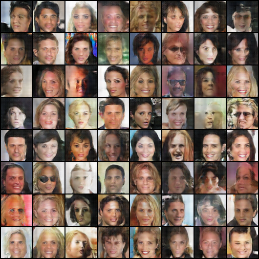
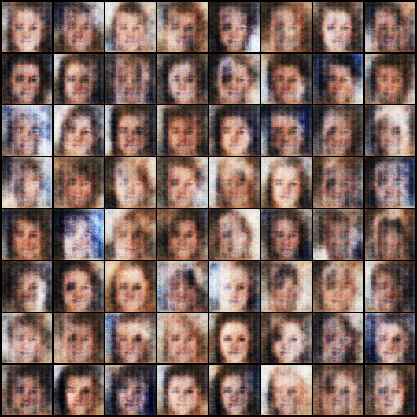
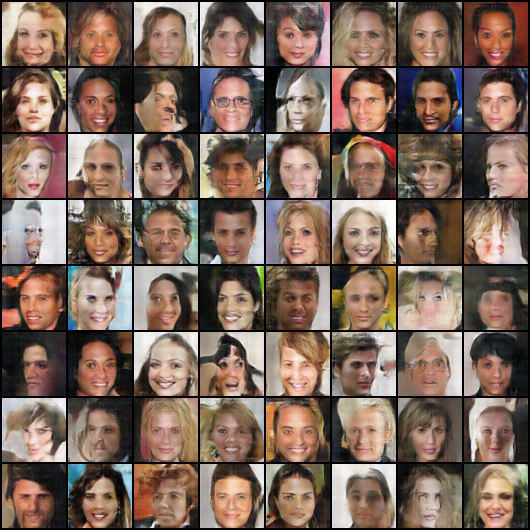

# Realistic Human Face Generation using GAN

A DCGAN built with PyTorch that learns to generate realistic synthetic human faces from random noise.

## Objective

- Understand how GANs generate new realistic images
- Build a Generator that creates synthetic faces
- Build a Discriminator that separates real and fake images
- Train both models with adversarial learning
- Evaluate the quality of generated faces during training

## Dataset

[CelebFaces Attributes (CelebA)](https://www.kaggle.com/datasets/jessicali9530/celeba-dataset) from Kaggle.
The first 50,000 images were used. The dataset is not included in this repo and is for non-commercial research use only.

## Preprocessing

- Center crop to 148x148 to focus on the face
- Resize to 64x64
- Normalize pixels to the range [-1, 1]

## Model

- **Generator:** latent vector (100) -> 5 transposed convolution layers with BatchNorm and ReLU -> Tanh -> 3x64x64 image
- **Discriminator:** 4 convolution layers with BatchNorm and LeakyReLU -> single real/fake score
- **Loss:** Binary Cross Entropy with logits, real label smoothing (0.9)
- **Optimizer:** Adam, learning rate 0.0002, beta1 0.5
- **Training:** 30 epochs, batch size 128

## Results

Generated faces after training:



Epoch 1:



Epoch 30:



Generated samples were saved every 5 epochs in the `samples` folder to track progress over time.

## How to run

1. Open `gan_face_generation.ipynb` in a Kaggle notebook
2. Add the CelebA dataset from Add Data
3. Turn on a GPU and run all cells

Install the libraries locally with:

```
pip install -r requirements.txt
```

## Files

- `gan_face_generation.ipynb` - full code and outputs
- `generator.pth` - trained Generator weights
- `samples/` - generated images during training and final faces
- `requirements.txt` - libraries used
